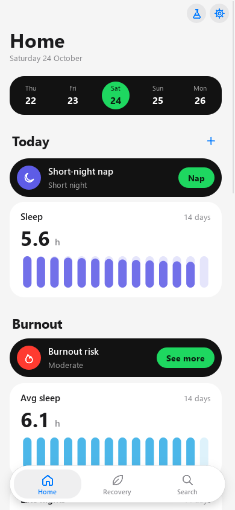
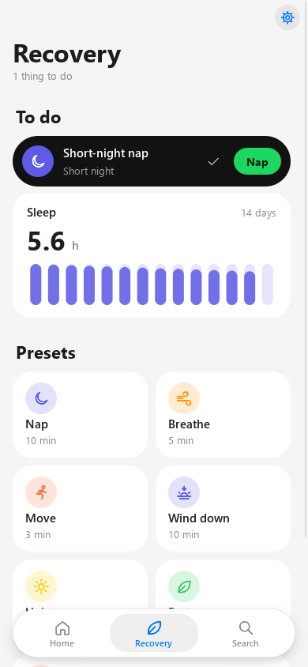
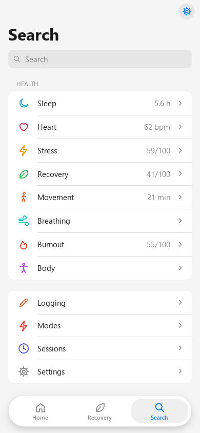
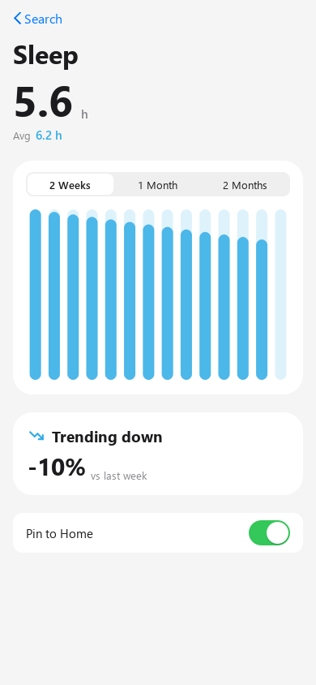
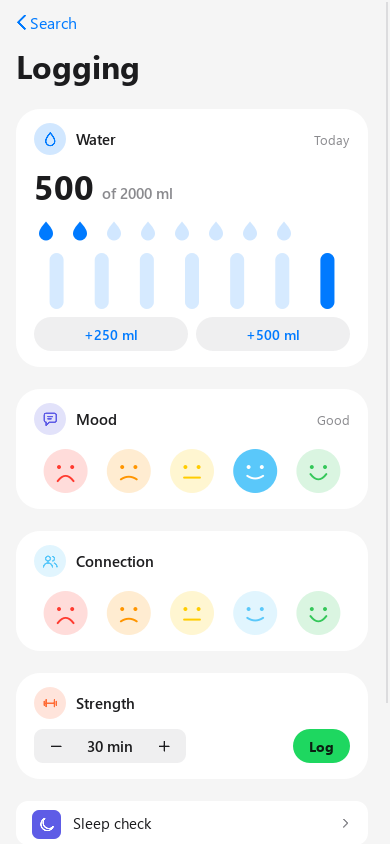
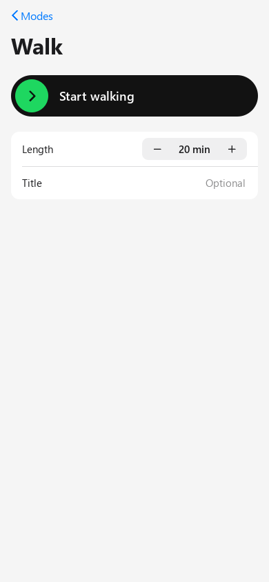
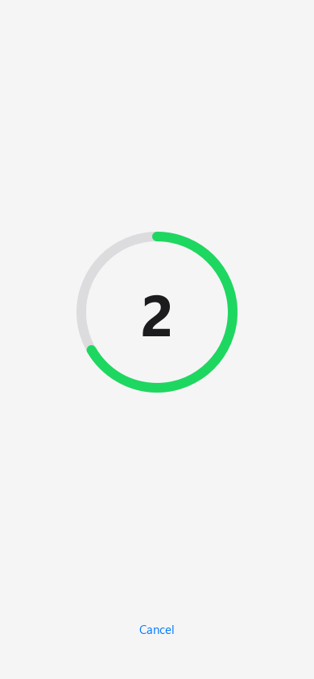
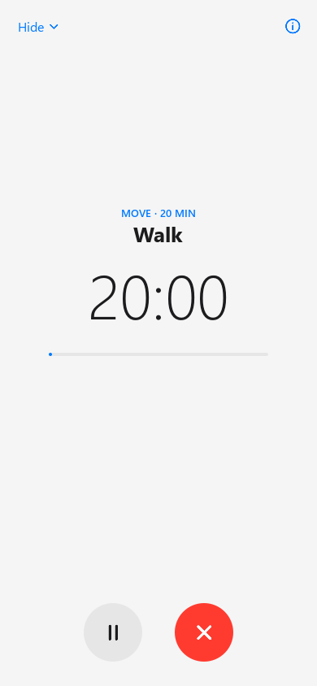
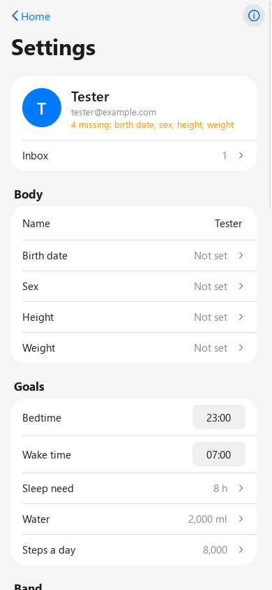
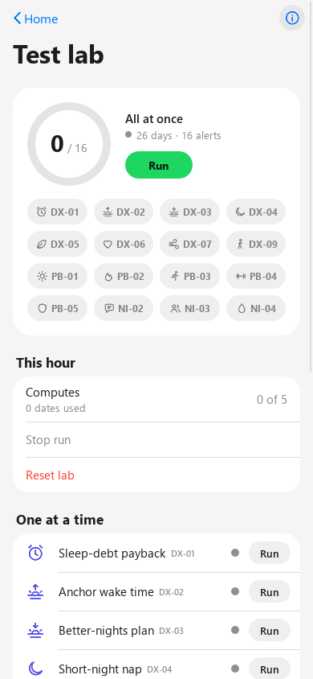

# Aura demo phone

A phone-sized PyQt6 app (390×844) for testing the 18 mobile features against the **dev** backend in us-west-1.
It signs in with a real Cognito account and has a built-in band simulator called the **Test lab**, so alerts can be
made to fire without a real band.

It only talks to dev. `config/aura-dev.json` holds public values (the pool, the app client id and the ten service
URLs). Dev has only the `mac` and `windows` Cognito app clients (`GET /v1/config` lists them), so the demo signs in
through the **windows** client. Both are public, allow email codes, and are accepted by every service API. Devices
still register as `android`. The config loader refuses `prod` and `ap-south-1`. Tokens are kept in Windows Credential Manager under
"AuraMobileDemo".

## Run

```
cd D:\intellj\aura\aura_mobile\demo
uv sync
uv run aura-mobile
```

**Signing in.** Enter an email, then the code that arrives. A new address signs up in the same step: its code is
6 digits, and a normal sign-in code is 8. Health data is on by default: every sign-in (and a restored session) turns the
health-data consent on if it is off, and a write refused with `consent_required` turns it on and is sent again
(it waits up to 10 s for Health Data to hear of it). Sign-in also registers this PC as a device.

> **SES sandbox.** Dev email is still in the SES sandbox, so codes only reach **verified** addresses. Use one that
> is verified in SES (us-west-1), or ask for it to be verified first.

Local state lives in `%APPDATA%\AuraMobileDemo`:

| File | What it holds |
|---|---|
| `lab-<sub>.json` | The dates the lab has used, its runs, and its compute calls |
| `prefs.json` | Pinned metrics, dark mode, and the device id |
| `aura-mobile.log` | The app's log |

## Screens

  

The look (24 Oct redesign) follows the old Figma "AURA CLARUS ANR APP" (exports in `../figma/`): simple and visual,
almost no text. An alert is a **black pill** with its icon, name, a two-word reason ("Short night") and one green
button ("Nap"); under it a **metric card** with the big number and 14 day-bars. Explanations live behind ⓘ, never in
footers; feature codes show only in the Test lab. Light and dark both work (Settings → Appearance). The design system
is in `ui/tokens.py` (colours, sizes), `ui/theme.py` (the stylesheet), `ui/icons.py` (line icons), `ui/kit.py`
(ActionPill, MetricCard, DayStrip, CategoryRow, StartPill, CountdownRing, RoundButton, IconTile, plus rows, groups,
switch, segmented control, stepper, nav bar) and `ui/layers.py` (Sheet, Alert, ActionSheet, the HUD pill). The short
copy per feature (`reason`, `verb`, `metric`, `icon`) is in `core/features.py`; the metric cards (label, unit, colour)
in `core/metrics.py` `CARDS`.

There are three tabs, following the sketch:

- **Home:** the 5-day strip; **Today**: up to 3 alert pills, each over its metric card (tap the pill for ⓘ, the
  button runs the action, + opens check-in / breathe / move / water); **Burnout**: the risk pill and Avg sleep, Late
  nights and Recovery cards (tap a card for its detail page); tasks as pills; this week's events; **Movement**
  (`weeklyActiveMinutes` against 150, DX-09); pins; **Finish your profile** while body details are missing (BS-01);
  the band's last sync with **Reconnect** (BS-02).
- **Recovery:** every open alert as a pill with a ✓ (Done) over its metric card, then the recovery presets as icon
  tiles. Each preset starts a Session in the full-phone timer.
- **Search:** a filter field, the health categories (Sleep, Heart, Stress, Recovery, Movement, Breathing, Burnout,
  Body) with their newest value, then:
  - a category opens its **detail page**: big number, Avg, 2 Weeks / 1 Month / 2 Months, the bars, the trend against
    last week, **Pin to Home**;
  - **Logging**: water in glasses against your goal, mood and connection as five faces, **Strength** (PB-04),
    **Sleep check** (DX-03), this week's history;
  - **Modes**: Timer, Flowtime, Walk, Meeting → a setup page with the big **Start** pill and Length → 3-2-1 → the timer;
  - **Sessions**: the running session (pause, stop, done) and the week's sessions; a completed recovery session has
    **Stress change** (DX-07);
  - **Settings**.

  

Timers (presets, the nap, slow breathing, move break, wind-down, modes) open a full-phone view: a big clock, round
pause and red stop buttons, a breathing circle for slow breathing, a black night view for the nap, and the list for
tomorrow during the wind-down. **Hide** shrinks it to a bar above the tabs; tap the bar to open it again. A finished
timer completes the Session; stop ends it. The bar also shows a session the server says is running.

  

**Settings** opens from the gear on every tab's nav bar; the **Test lab** from the flask on Home. Both close with **‹ Back** (or Esc):

- **Settings** (gear, BS-01): name and body details (each row opens a sheet and saves at once), goals (saved as a
  second write, so a refused goal doesn't lose the body details), the band (pair, sync, last sync), the 17 alert
  switches by name, the inbox (one row that opens a sheet: read, dismiss, snooze), export, delete account, dark mode
  and sign out.
- **Test lab** (flask button): the month ring "x / 16" with **Run** and a chip per alert (grey waiting, green fired,
  red failed), then one line per feature with a status dot and **Run**. Tap a row for its sheet: the scenario, the
  rule and what AWS did at every look ("AWS computed 21 Oct at 21:05: sleepLatencyMin = 39 (rule: > 30 on 4+
  nights). No alert yet", until **Passed**), with **Check now**.

## Test lab



**Run** sends that feature's synthetic band days, one packet a minute, the same as the band. It always uses **past,
unused** dates: a day that was computed before keeps its result, and each feature can raise only one alert per day.
About 2 minutes after the last packet, Health Data computes the day itself. The row then watches `GET /v1/alerts`
and shows **Passed** when the alert appears, and the alert shows on Recovery and Home.

- **Compute now** spends one of the backend's **5 computes an hour** instead of waiting about 2 minutes. The lab counts them and refuses a 6th.
- **Direct** rows cross a raw threshold and fire reliably. **Derived** rows push a composite score, so the result depends on the deployed pipeline and the account's history, and they may need a second run.
- Runs only write into the **last 33 days**: Health Data keeps band minutes 35 days from their own time, and older ones can vanish before the day is computed. That is room for a few scenarios per account (all 18 need ~140 days). When rows say **No room left**, wait for new days, or delete the account in Profile and sign up again. **Reset lab** only forgets which dates were used; re-sending over used dates mixes old and new data.
- **All features at once** (top row) sends **one 26-day month** ending on a Monday, on the same dates for every
  feature, the way a real person's month would look. It should raise 16 alerts (all but BS-02, which needs empty days).
  It needs 27 unused days in a row (a fresh account) and your **birth date in Profile** (VO2max, PB-04, needs it).
  It was proven offline through Health Data's own day pipeline before it was added. The row lists which alerts are in
  and which are still to come; NI-04's timer takes about 2 h.
- **Push is not set up** on dev (the APNs secret is empty). Alerts arrive in the in-app inbox and on Recovery. The app checks again every minute.

## Per-feature test guide

The pill's green button says the short verb (`Feature.verb`, e.g. **Bedtime**, **Breathe**); the bold step below
is what it does.

| Feature | Lab run sends | Then, in the app |
|---|---|---|
| DX-01 Sleep-debt payback (derived) | 14 short nights (5 h 45 m) | **Set an earlier bedtime**: moves the bedtime goal 30 min earlier. The phone reminds you 30 min before bed (local alarm, while the app is open) |
| DX-02 Anchor wake time (derived) | Two weeks of bedtimes swinging 20:00 / 03:00 (waking 03:45 / 10:45), ending on a Monday | **Pick one wake time**: sets the wake-time goal; the wake alarm rings at that time (local) |
| DX-03 Better-nights plan (derived) | 5 nights that each take 45 min to fall asleep | **Start the wind-down**: 10-min timer with a to-do box; each line becomes a task. Once DX-03 has fired in 3 different weeks, it offers the **sleep check** (7 ISI questions, score of 28) |
| DX-04 Short-night nap (direct) | One 5 h 30 m night | **Start a 10-min nap**: timer, saved as a Session |
| DX-05 Easy-day call (derived) | 9 calm nights, then a short night with high HR and low HRV | **Start a recovery break**: lists today's and tomorrow's hard training (gym, run, HIIT…) to move to tomorrow, then a 10-min recovery break |
| DX-06 Getting-ill warning (derived) | 10 calm nights, then HR +10, low HRV, skin +0.6 °C | **Take it easy**: cancels the hard training you tick and can set bedtime 30 min earlier |
| DX-07 Stress reset (derived) | A 2-hour still, fast-heart, low-HRV stretch | **Breathe for 5 min**: breathing guide, then the stress change (before vs after) from the session trace; also under Search → Sessions → **Stress change** |
| DX-09 Weekly movement target (direct) | A near-sedentary week ending on a Thursday | **Add two walks**: calendar events on Sat and Sun. Home shows **Movement this week** against 150 min |
| PB-01 Body-clock reset (derived) | The sleep window jumps from 23:00 to 01:00–03:00 | **Plan morning light**: 3 mornings of 15-min outdoor light 30 min after your wake time (07:30–09:30), and **Dim screens** at 21:00 |
| PB-02 Burnout early warning (derived) | 3 weeks of short sleep, high HR and heavy load, ending on a Monday | **Plan a recovery day**: event tomorrow, then a mood check |
| PB-03 Sitting breaker (direct) | One unbroken 95-min desk bout | **Move for 3 min**: timer |
| PB-04 Fitness keeper (derived) | A fit week that fades into 3 sedentary weeks | **Plan 3 sessions**: 18:00 events on days +1, +3 and +5. Search → Logging → **Strength** logs a session by hand |
| PB-05 Health-check flag (derived) | 10 nights with 15 SpO2 dips each | **Book a check-up**: adds a 'Book a doctor visit' task |
| NI-02 Mood check + help (direct) | 3 low mood check-ins, then a band day | **Check in on mood**: help options (Tele-MANAS 14416, iCall, 112) when the mood is 2 or lower or low most of the week; can add 'Reach out to someone' to tasks |
| NI-03 Connection nudge (direct) | A day on the 1st or 15th with no connection check-ins | **Log connection**: plan a call today (task) and/or a meal this week (event), then the connection check-in |
| NI-04 Hydration reminder (direct) | A final day that books the hydration timer | Fires **about 2 h later** if today's water is behind the goal. Don't log water until it arrives. **Drink** logs a glass; Search → Logging shows glasses and ml |
| BS-01 User identity & data | (no lab run) | Profile: name and body details (birth date, sex, height, weight), goals, alert switches, export, delete. Home shows **Finish your profile** while details are missing |
| BS-02 Band connection & sync (direct) | Computes an empty day after another empty day (1 compute) | **Reconnect the band**: sends what the band kept since the last sync (30 min to 12 h). Profile → Band pairs one (`pairedBandId` setting) and shows the last sync; Home warns after 24 h |

Every action ends with `POST /v1/alerts/{id}/done`, so the alert leaves Recovery. A timer that runs out beeps. A new alert
arriving while the app is open shows a banner and flashes the taskbar.

**On dev today** (22 Oct): Identity has its mobile routes again and `scripts/live_check.py` passes all 30 checks
(consent, goals, check-ins, logs, samples, export). If the server refuses an action, it still shows on screen at
once; then the toast says why and the screen goes back.

**Checking that a switched-off alert stays quiet:** in Settings, turn a feature off (for example DX-04). Run it in
the lab. The row should time out with no alert. Turn it back on and run again: it should pass.

**Suggested order for a first pass:**
1. DX-04, PB-03 and DX-09, which are direct and fast.
2. NI-02 and BS-02.
3. The derived rows.
4. NI-04, which takes about 2 h.

## Develop

```
uv run pytest        # 181 tests: config, HTTP rules, routes, simulator, lab runner, store, feature steps, offscreen UI
uv run ruff check src tests scripts
```

The code is layered `ui → services → core` (`core` has no Qt), following the Windows app's rules:
- Workers are kept alive in `ui/tasks.py`.
- Signals connect to bound methods.
- A widget is hidden before `deleteLater()`.

### Why a tap shows at once

Each call from India to us-west-1 takes 0.25–0.9 s, so the app never waits for the server to show a change:
- `ui/store.py` caches what the screens show. At sign-in every part loads **in parallel** (about 0.8–1.3 s for all
  eleven, against about 4.8 s one after another). Connections are kept open for 120 s.
- At most 6 calls are open at once (`MAX_IN_FLIGHT` in `services/http.py`). Dev runs at most 10 Lambdas at once for
  the whole account in us-west-1; more than that and API Gateway answers 503 ("throttled, retrying in 1 s" in the
  log). There are no `/v1/health` warm-up pings at sign-in for the same reason.
- A tap changes the cache first (`store.patch`), so the screen redraws in 1–3 ms. Then `ctx.write` sends the call
  and reloads that part to confirm (0.3–0.7 s). If the server refuses, a toast says why and the reload puts back the
  server's state.
- A load that started before a tap is dropped when it lands, so a slow answer can't undo the tap.
- Pages redraw only the cards whose parts changed. Switching tabs draws from the cache and re-asks only for parts
  older than 30 s.

`services/sim/band.py` is a port of `aws_docs/services/health-data/test/e2e/band.ts` (same seeded RNG).
`services/sim/scenarios.py` holds one scenario per alert feature.
